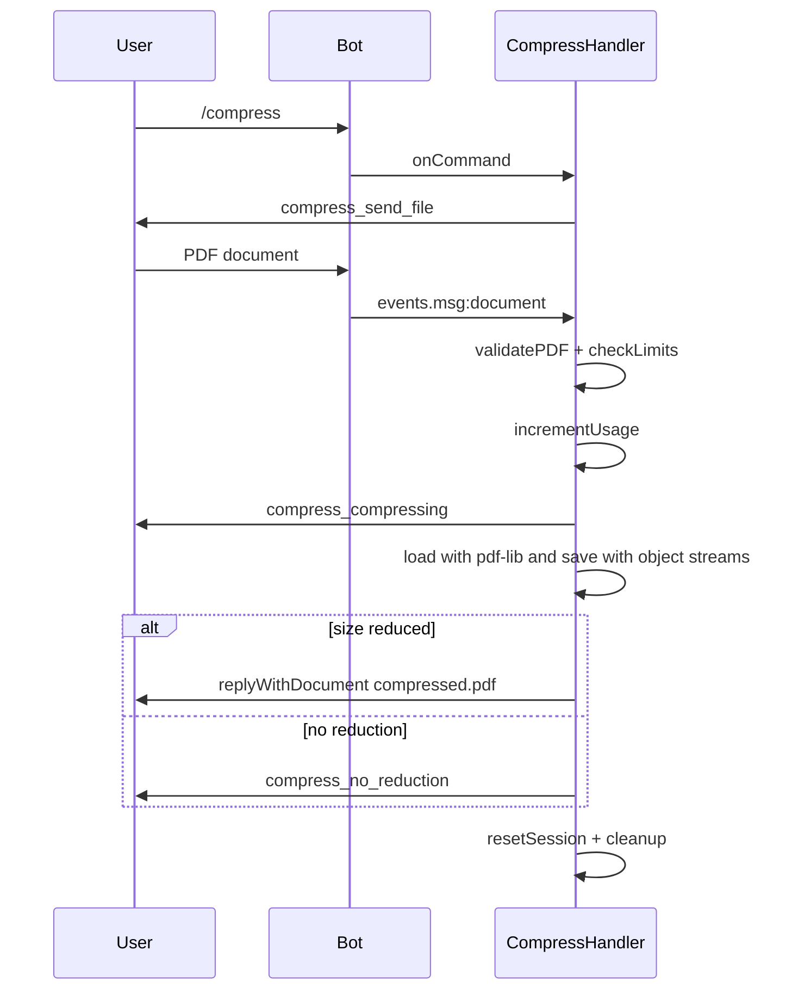
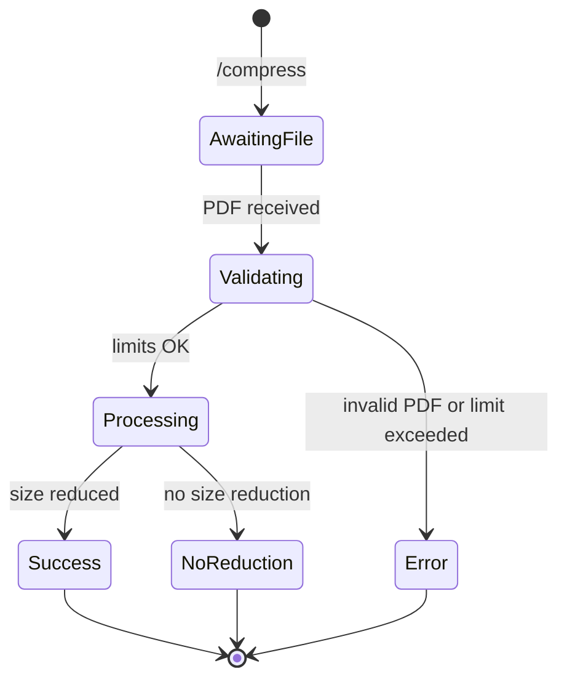

# Compress

## Overview

The `/compress` command reduces PDF file size by rewriting the document with object streams enabled.

## Business Rules

- Only valid PDF documents are accepted.
- If compression does not reduce the file size, the user is informed instead of receiving a larger file.
- Consumes one daily operation.

## User Flow

## State Machine

## Technical Notes

- Handler: `CompressHandler`.
- Uses `PDFDocument.load` and `pdfDoc.save({ useObjectStreams: true })` from `pdf-lib`.
- `BaseHandler.processDocument` manages validation, limits, download, usage accounting, and cleanup.
