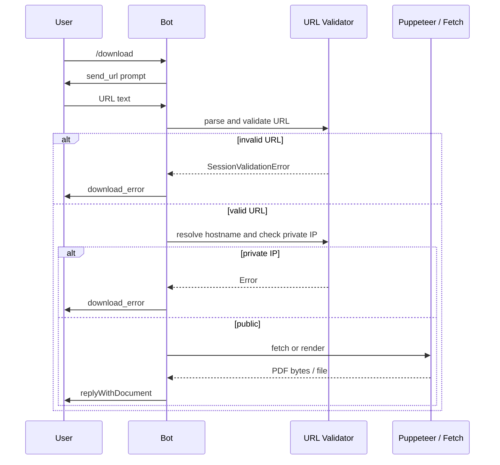
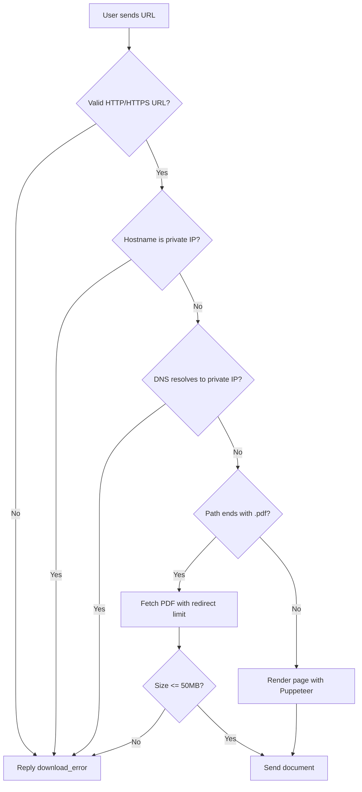

# Download

## Overview

The `/download` command converts a URL into a PDF. If the URL points directly to a `.pdf` file, the file is fetched and returned. Otherwise, the webpage is rendered with Puppeteer and printed to PDF.

## Business Rules

- URL must use `http:` or `https:`.
- Private IP addresses and internal networks are blocked to prevent SSRF.
- Direct PDF downloads are capped at 50 MB.
- Webpages are rendered as A4 PDFs with 1 cm margins.

## User Flow

## State Machine

## Technical Notes

- Handler: `DownloadHandler` uses Puppeteer for HTML pages and `fetch` for direct PDFs.
- SSRF protection checks both the hostname and resolved DNS addresses with `ipaddr.js`.
- Request interception inside Puppeteer aborts requests to private IPs.
- Max redirects: 5. Fetch timeout: 30 seconds.
