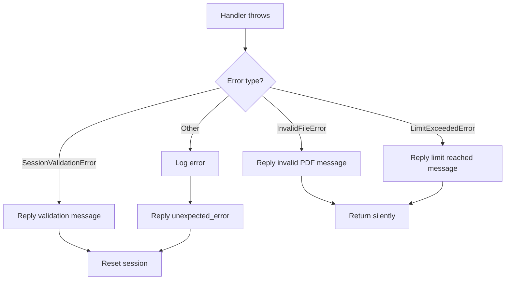
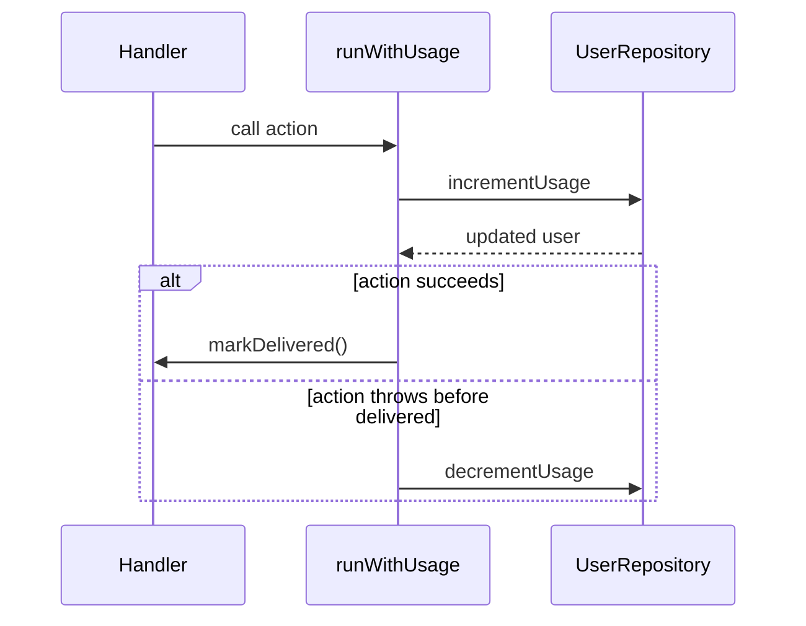

# Error Handling

## Overview

Errors are caught at the handler boundary in `src/index.ts` and mapped to localized user messages. Unexpected errors are logged and reported as a generic failure message.

## Error Classification

| Error | Meaning | User-facing behavior |
|-------|---------|----------------------|
| `SessionValidationError` | Invalid or missing session parameters. | Reply with `⚠️ {error.message}` and reset session. |
| `InvalidFileError` | The message is not a valid PDF document. | Reply with the localized `invalid_pdf` message. |
| `LimitExceededError` | File size or page count exceeds plan limits. | Reply with `free_limit_reached` or `pro_limit_reached`. |
| `UserNotFoundError` | No user record exists in the database. | Treated as unexpected error. |
| Other errors | Unexpected failures (PDF parsing, network, etc.). | Log error and reply with `unexpected_error`. |

## Global Handler Error Flow

## Per-Handler Error Patterns

Most PDF handlers wrap processing in a `try/catch/finally` block:

1. Validate PDF MIME type.
2. Enforce size/page limits.
3. Reserve usage counter.
4. Download and process file.
5. Send result.
6. Clean up temporary files and reset session.

If a known error (`InvalidFileError`, `LimitExceededError`) is caught, the handler returns without sending an extra error message because the validation/limit methods already reply. Unexpected errors trigger the localized `*_error` key and are logged.

## Usage Accounting on Failure

`BaseHandler.runWithUsage` increments the daily counter before processing. If the action throws before `markDelivered()` is called, the counter is decremented automatically so the user is not charged for failed operations.

