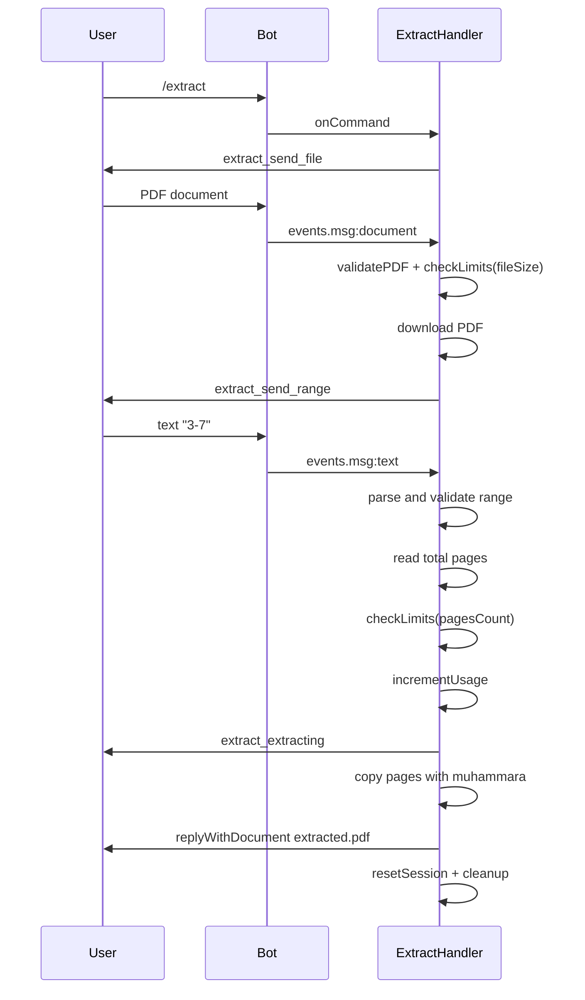
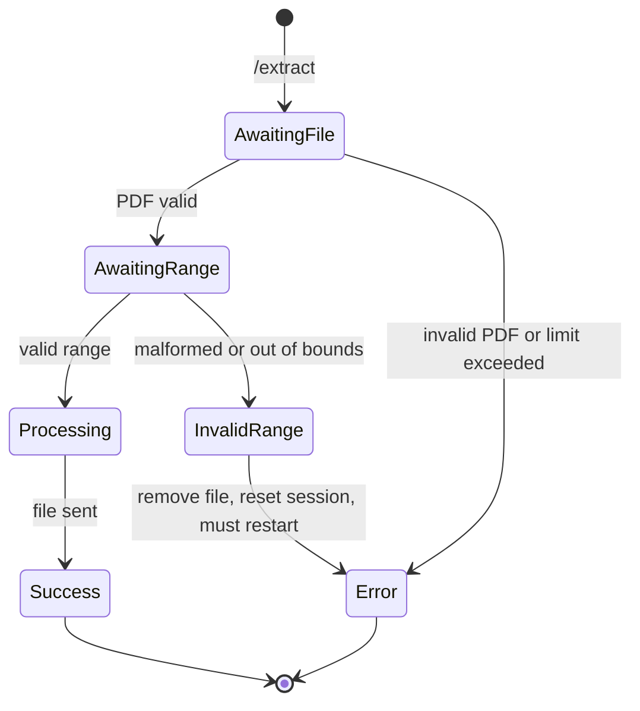

# Extract

## Overview

The `/extract` command extracts a contiguous range of pages from a PDF and returns a new file containing only those pages.

## Business Rules

- The user must first send the PDF, then send the range in the format `start-end` (e.g., `3-7`).
- Range bounds are validated against the actual page count.
- Consumes one daily operation.

## User Flow

## State Machine

## Technical Notes

- Handler: `ExtractHandler`.
- Stores the downloaded file path in `session.params.path` between turns.
- Uses `muhammara.createWriter` and `appendPDFPageFromPDF` to copy the selected pages.
- Input and output files are removed after processing.
