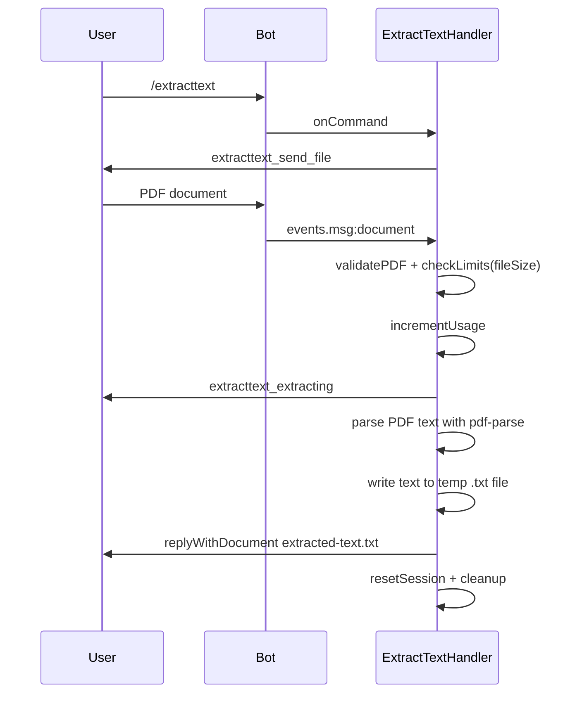
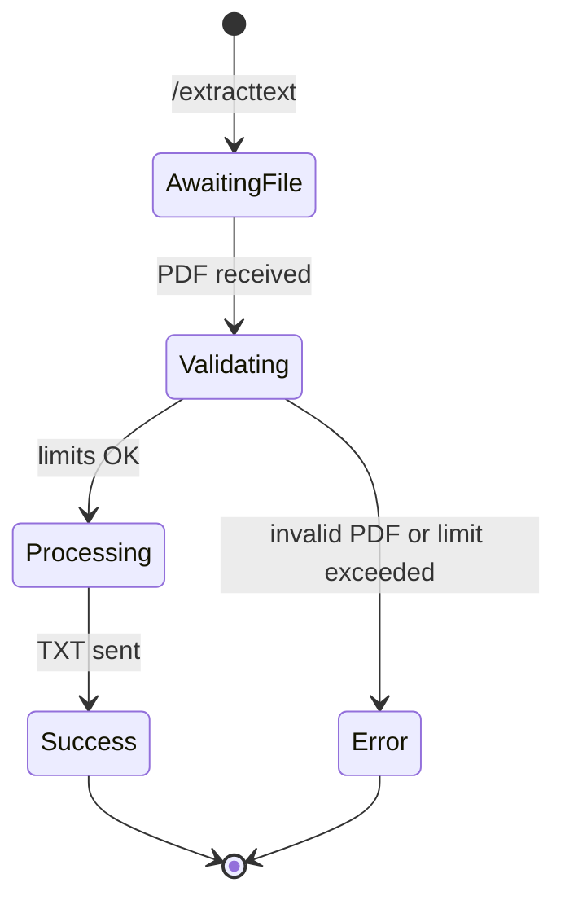

# ExtractText

## Overview

The `/extracttext` command extracts the text content of a PDF and returns it as a `.txt` file.

## Business Rules

- Only valid PDF documents are accepted.
- File size is validated against plan limits.
- If the PDF contains no extractable text, the result file may be empty.
- Consumes one daily operation.

## User Flow

## State Machine

## Technical Notes

- Handler: `ExtractTextHandler`.
- Uses `pdf-parse` to extract text content.
- The output text is written to a temporary `.txt` file and sent with `InputFile`.
