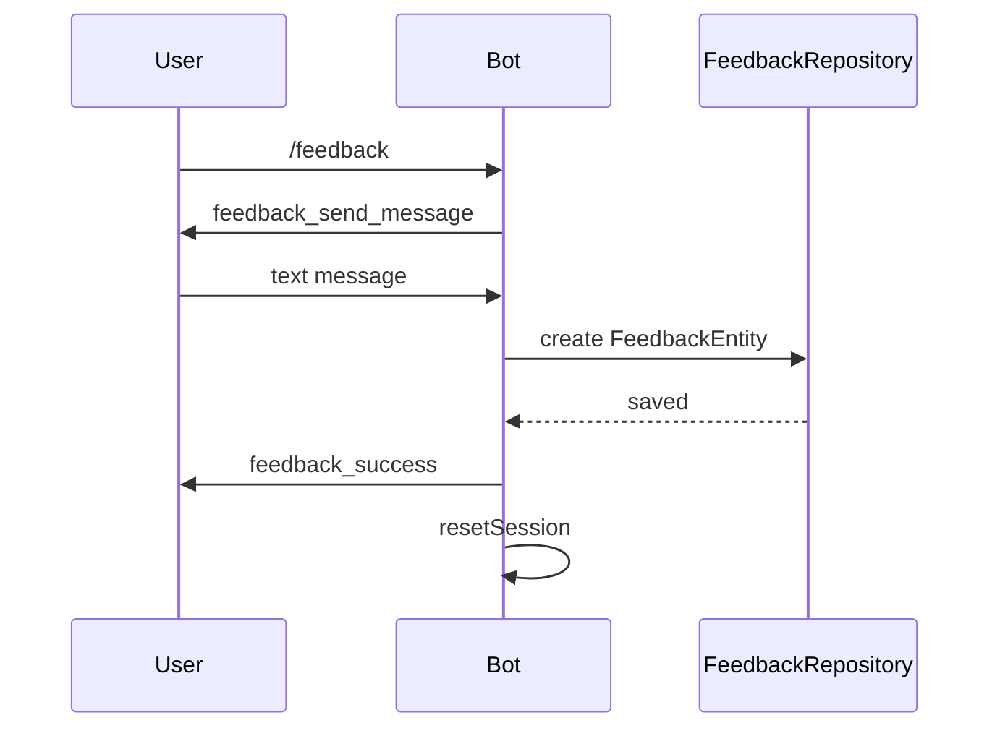
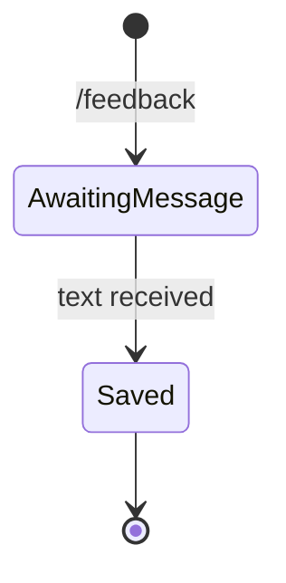

# Feedback

## Overview

The `/feedback` command lets users send free-text suggestions or bug reports directly to the developer.

## Business Rules

- No usage limit is consumed.
- Each feedback is stored with the sender's Telegram user info and timestamp.
- The session is reset after the message is saved.

## User Flow

## State Machine

## Technical Notes

- Handler: `FeedbackHandler`.
- Stores `telegram_user`, `text`, and `created_at` in the `feedbacks` collection.
