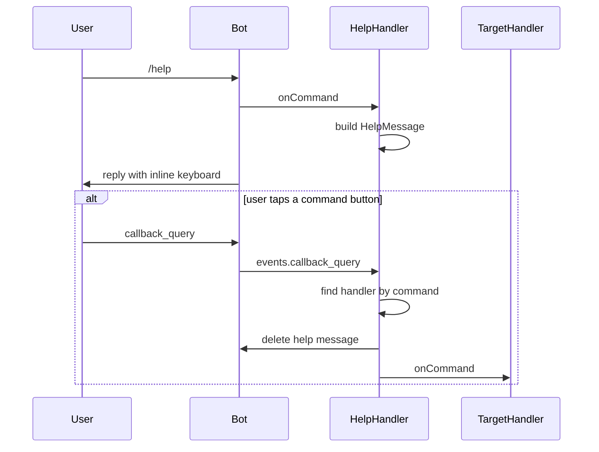
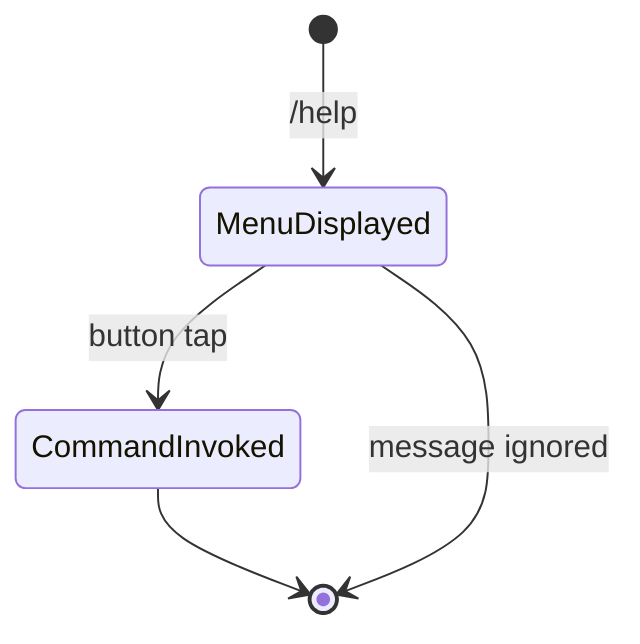

# Help

## Overview

The `/help` command displays an interactive menu with all available commands. Users can tap a button to invoke a command directly.

## Business Rules

- No usage limit is consumed.
- The menu is generated dynamically from the registered handlers list.
- Tapping a button deletes the help message and triggers the selected command.

## User Flow

## State Machine

## Technical Notes

- Handler: `HelpHandler` receives the full handler array and includes itself.
- Buttons use `InlineKeyboard` with command names as callback data.
- Unknown buttons are answered with `answerCallbackQuery` at the bot level in `src/index.ts`.
