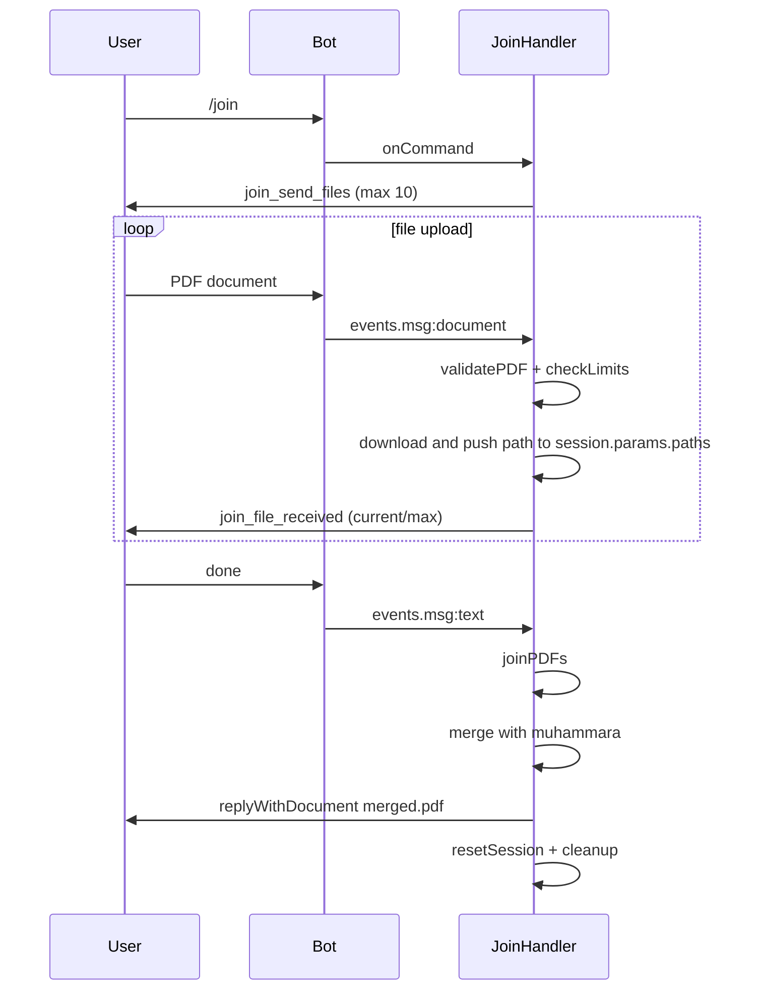
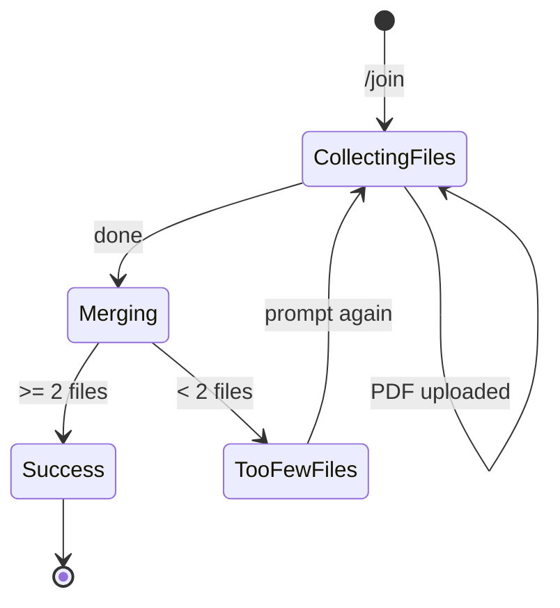

# Join

## Overview

The `/join` command merges multiple PDF files into a single document. Users send files one by one and type `done` to trigger the merge.

## Business Rules

- Minimum of 2 files; maximum of 10 files.
- Each uploaded file must be a valid PDF.
- Each upload is validated against plan size limits.
- Consumes one daily operation when the merge is executed.

## User Flow

## State Machine

## Technical Notes

- Handler: `JoinHandler`.
- Stores an array of downloaded file paths in `session.params.paths`.
- Merging uses `muhammara.createWriter` and `appendPDFPagesFromPDF`.
- Temporary output directory is removed in the `finally` block.
