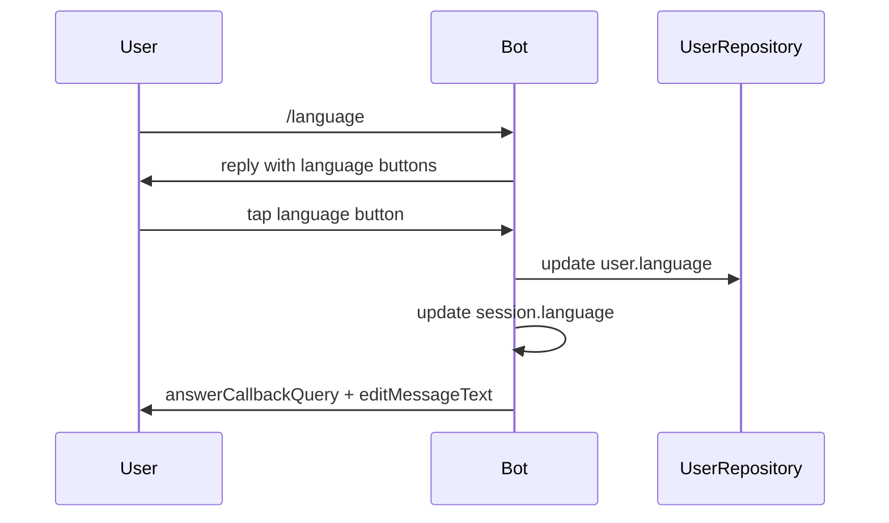
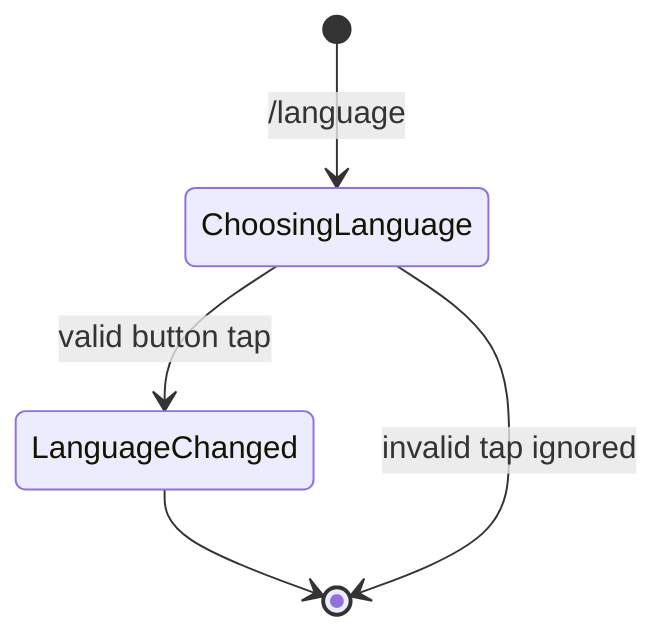

# Language

## Overview

The `/language` command lets users switch the bot interface between English, Portuguese, and Spanish.

## Business Rules

- No usage limit is consumed.
- The change is persisted to the user profile and stored in the session.
- Unsupported Telegram language codes fall back to English.

## User Flow

## State Machine

## Technical Notes

- Handler: `LanguageHandler`.
- Allowed languages are driven by `LanguageEnum`.
- Translations are loaded from `src/locales/{en,pt,es}.json` by `i18nMiddleware`.
