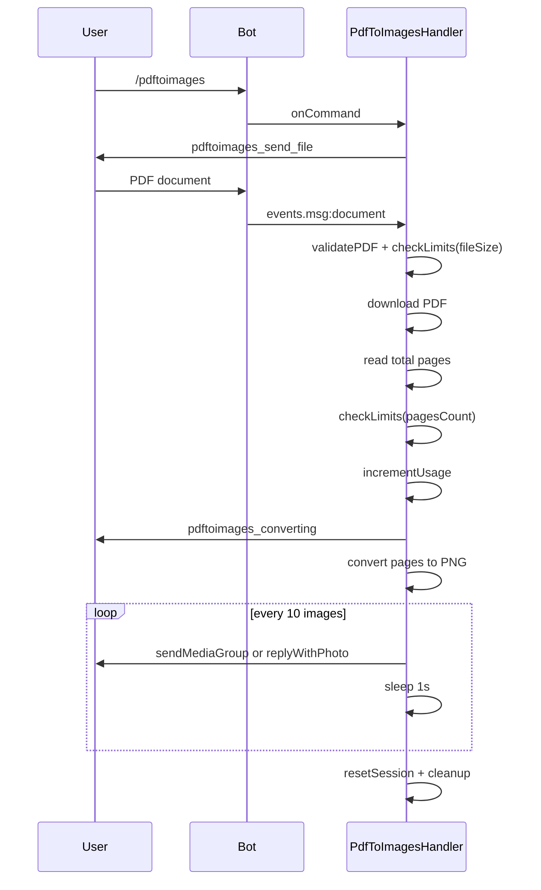
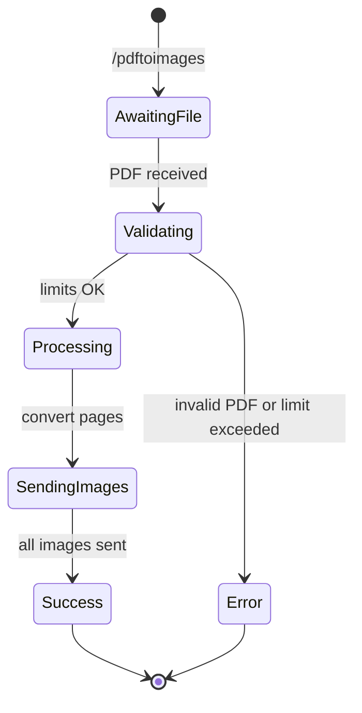

# PdfToImages

## Overview

The `/pdftoimages` command converts each page of a PDF into a PNG image. Images are sent in groups of up to 10 per message to reduce chat clutter.

## Business Rules

- Only valid PDF documents are accepted.
- Total page count is validated against plan limits.
- Images are sent as a media group when there are multiple pages.
- A 1-second delay is applied between chunks to respect Telegram rate limits.
- Consumes one daily operation.

## User Flow

## State Machine

## Technical Notes

- Handler: `PdfToImagesHandler`.
- Uses `pdf-to-img` to render pages as PNG buffers.
- `sendImageChunks` groups images into chunks of 10 and sends them via `sendMediaGroup` or `replyWithPhoto`.
- Output directory and input file are removed after processing.
