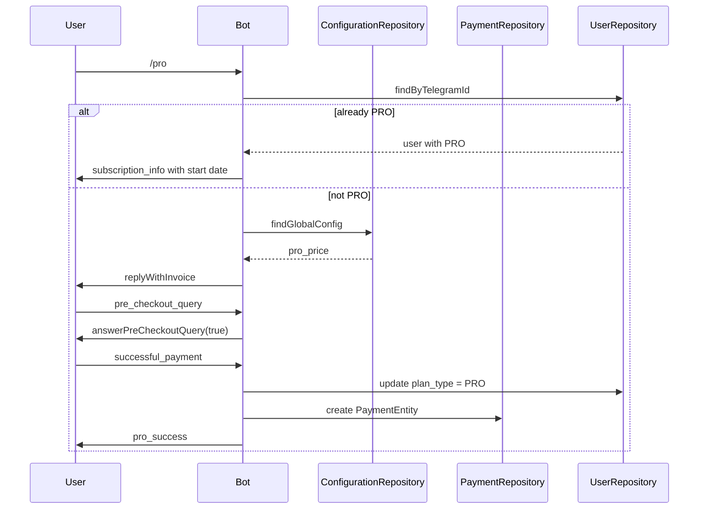
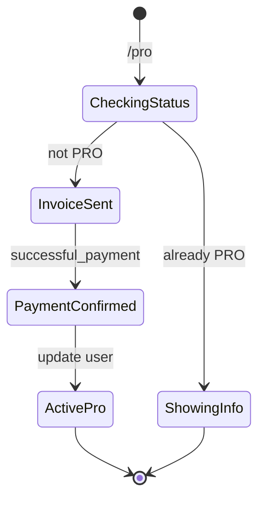

# Pro

## Overview

The `/pro` command upgrades a user to the PRO plan using Telegram's native payment flow with Telegram Stars (XTR).

## Business Rules

- If the user is already PRO, the bot shows the subscription start date.
- PRO lasts 30 days from payment confirmation.
- The price is read from the global configuration (`pro_price`).
- No usage limit is consumed by invoking `/pro`.

## User Flow

## State Machine

## Technical Notes

- Handler: `ProHandler`.
- Listens to `pre_checkout_query` and `message:successful_payment` events.
- Payment payload is `'pdf-studio-pro-subscription'`.
- Currency is `XTR` (Telegram Stars).
- `usageLimitMiddleware` checks PRO expiration daily and downgrades expired plans.
