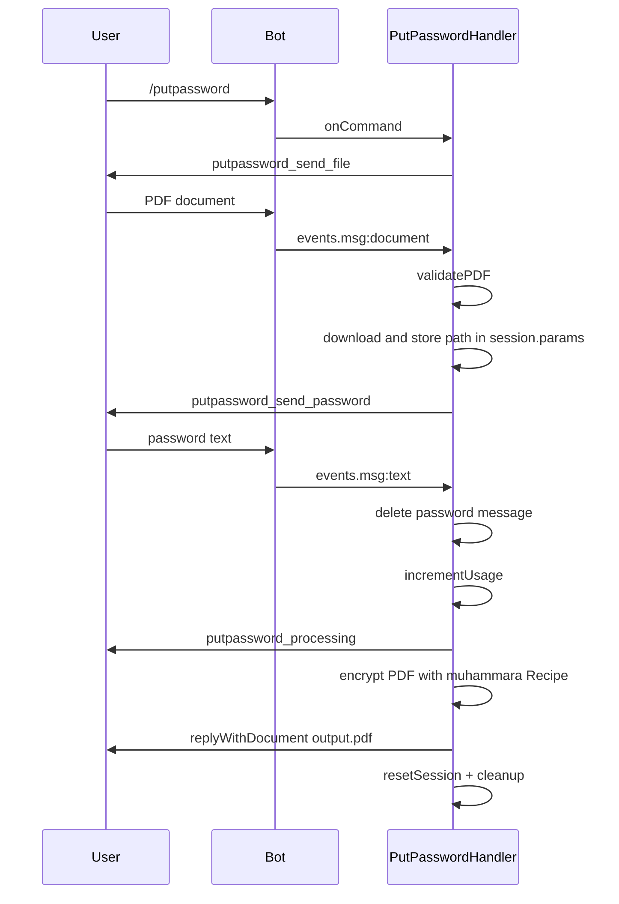
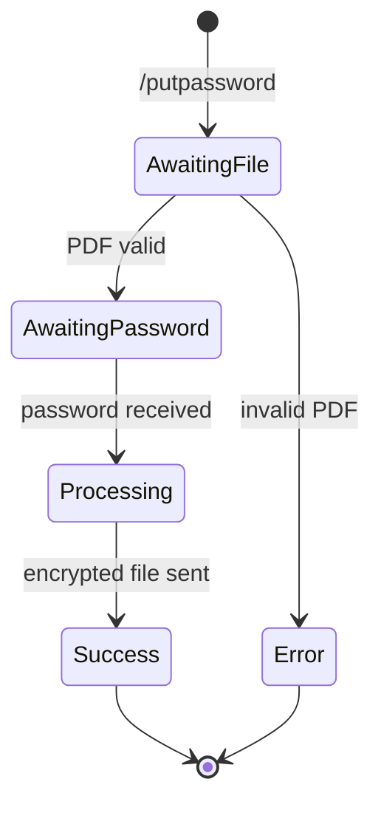

# PutPassword

## Overview

The `/putpassword` command encrypts a PDF with a user-provided password.

## Business Rules

- User sends the PDF first, then sends the desired password as a text message.
- The password message is deleted after processing to reduce exposure in the chat.
- Consumes one daily operation.

## User Flow

## State Machine

## Technical Notes

- Handler: `PutPasswordHandler` extends `PasswordBaseHandler`.
- Encryption uses `muhammara.Recipe(...).encrypt({ userPassword: password }).endPDF()`.
- Base class handles session state, validation, and cleanup.
