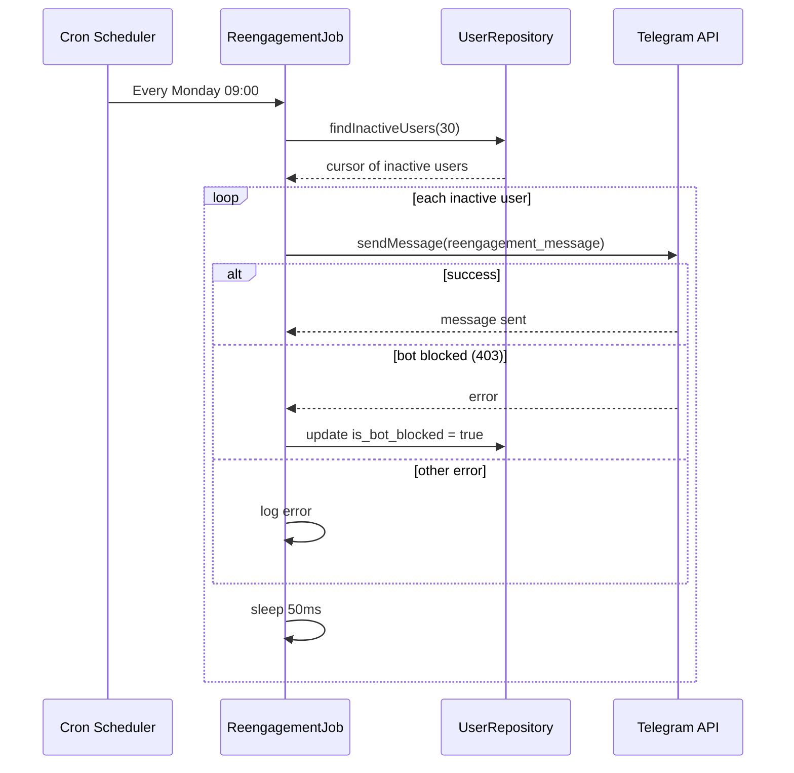

# Re-engagement Job

## Overview

A scheduled background job reminds inactive users to return to the bot. It runs weekly on Mondays at 09:00.

## Business Rules

- Target users who have not interacted for **30 days**.
- Exclude blocked users and users who have blocked the bot.
- Respect Telegram rate limits by sleeping 50 ms between messages.

## User Flow

## Technical Notes

- Implemented in `src/jobs/reengagement.job.ts` using `node-cron`.
- Uses `UserRepository.findInactiveUsers(30)` to query the cursor.
- Sends the localized `reengagement_message` via `bot.api.sendMessage`.
- If the bot was blocked by the user (HTTP 403), marks `is_bot_blocked = true`.
