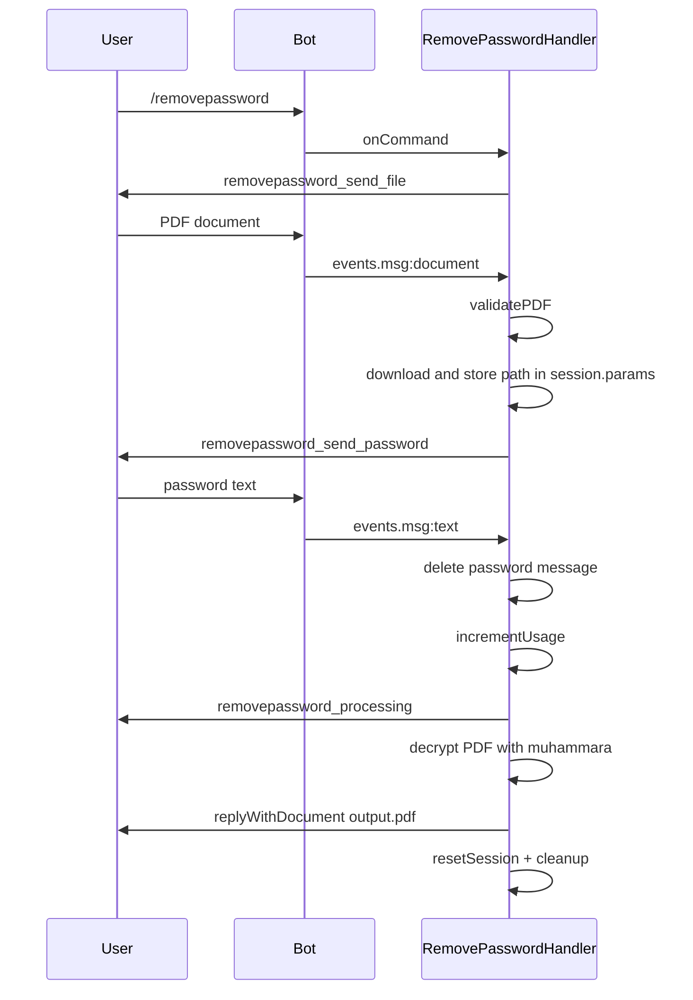
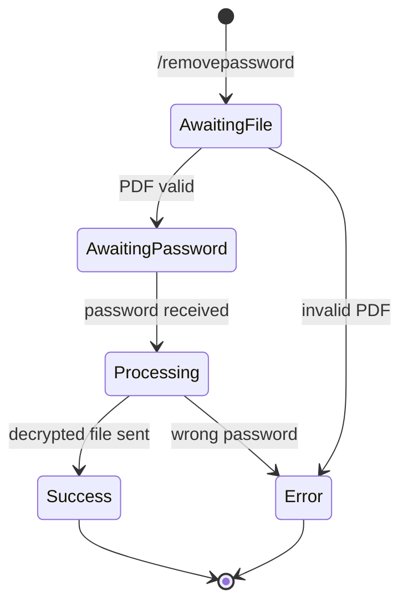

# RemovePassword

## Overview

The `/removepassword` command removes password protection from a PDF, given the current password.

## Business Rules

- User sends the password-protected PDF first, then sends the current password.
- The password message is deleted before processing (best-effort; processing continues if deletion fails).
- If the password is incorrect, processing fails and the user receives an error.
- Consumes one daily operation.

## User Flow

## State Machine

## Technical Notes

- Handler: `RemovePasswordHandler` extends `PasswordBaseHandler`.
- Decryption uses `muhammara.createWriter(output).appendPDFPagesFromPDF(input, { password })`.
- The writer is closed safely even when decryption fails.
