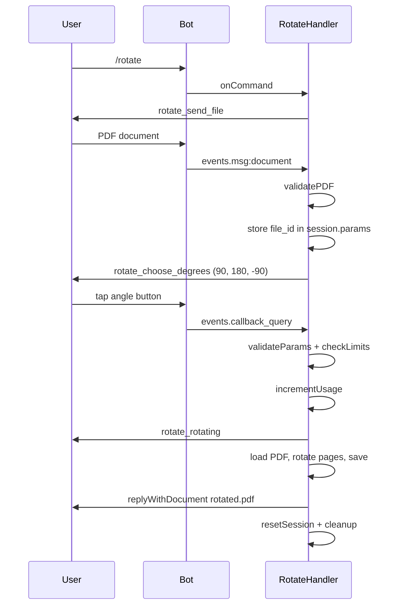
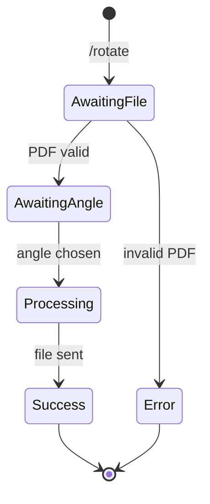

# Rotate

## Overview

The `/rotate` command rotates all pages of a PDF by 90°, 180°, or -90°.

## Business Rules

- User sends a PDF, then chooses the rotation angle from an inline keyboard.
- The rotation is relative to each page's current rotation.
- Consumes one daily operation.

## User Flow

## State Machine

## Technical Notes

- Handler: `RotateHandler`.
- Stores `file_id` instead of a local path because the file is downloaded after the angle is chosen.
- Uses `PDFDocument.load` and `page.setRotation(degrees(...))` from `pdf-lib`.
- Rotation is normalized to the `[0, 360)` range.
