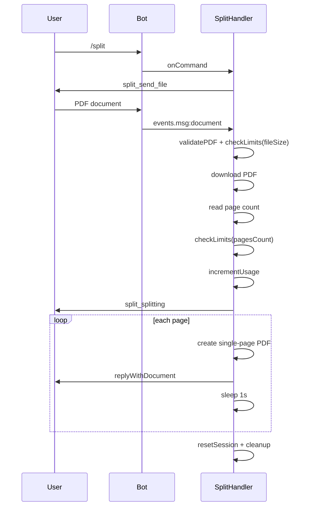
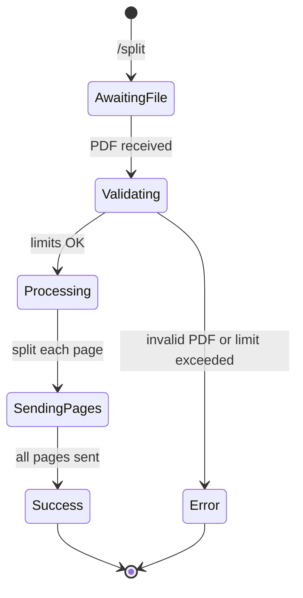

# Split

## Overview

The `/split` command breaks a multi-page PDF into individual single-page PDF files, sending each as a separate document.

## Business Rules

- Only valid PDF documents are accepted.
- The total page count is validated against the user's plan limit.
- One file is sent per page with a 1-second delay between messages to avoid Telegram rate limits.
- Consumes one daily operation.

## User Flow

## State Machine

## Technical Notes

- Handler: `SplitHandler`.
- Uses `muhammara.createReader` to count pages and `muhammara.createWriter` to copy individual pages.
- Temporary input file and output directory are removed in the `finally` block.
