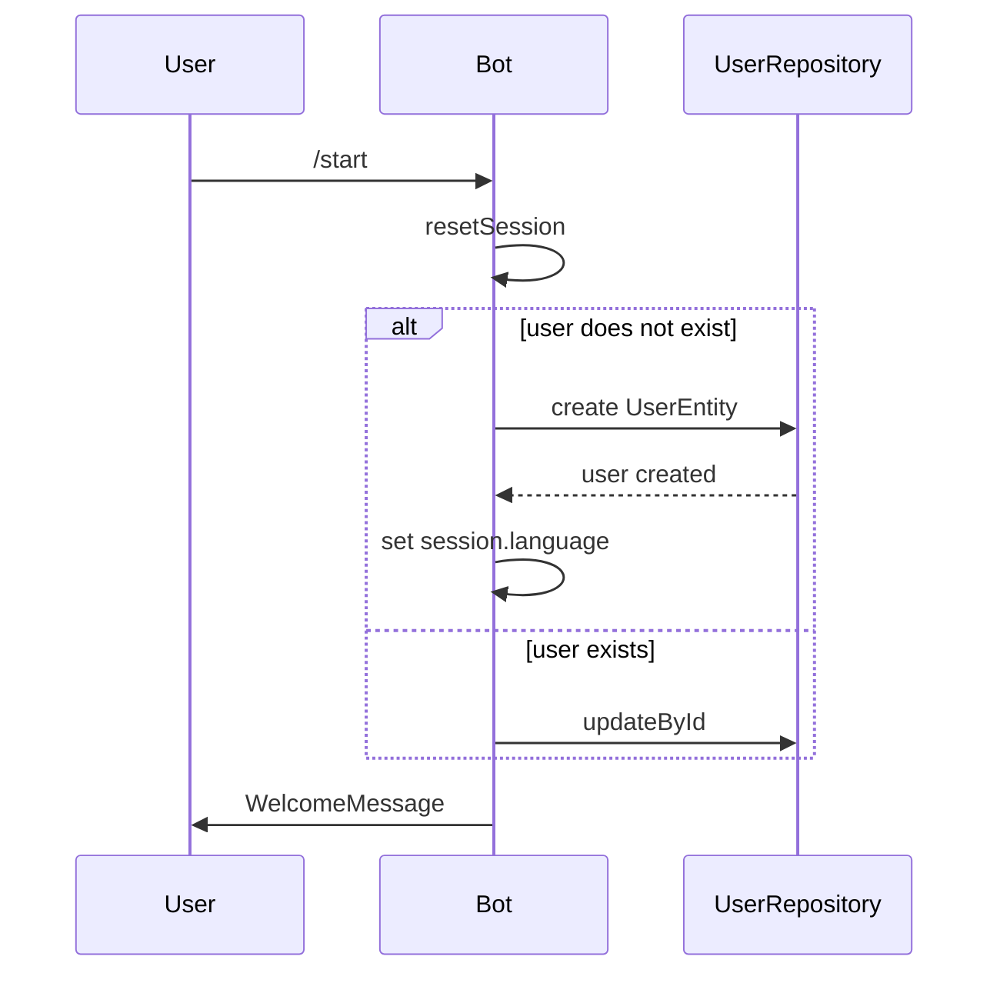
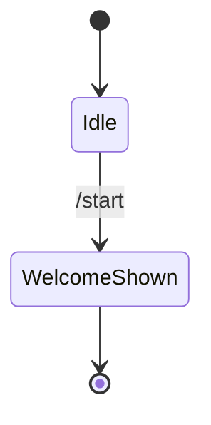

# Start

## Overview

The `/start` command is the entry point for new and returning users. It creates a user record on first use and refreshes the profile on subsequent visits.

## Business Rules

- No usage limit is consumed.
- The welcome message is the first touchpoint for onboarding.
- Language is inferred from the Telegram client's `language_code` when supported; otherwise it defaults to English.

## User Flow

## State Machine

`/start` is a single-step command with no multi-turn state.

## Technical Notes

- Handler: `StartHandler` extends `BaseHandler` with `hasUsageLimits = false`.
- New users are persisted with `telegram_user`, `language`, and default free plan fields.
- Existing users are updated to keep the profile in sync.
