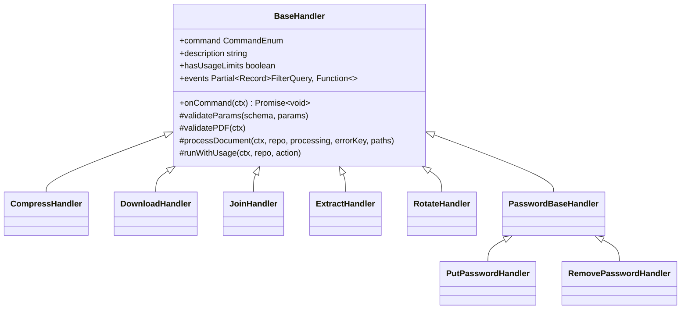

# Technical Overview

## Tech Stack

- **Runtime**: Node.js with TypeScript (strict mode).
- **Bot framework**: [grammY](https://grammy.dev) with `@grammyjs/runner`, `@grammyjs/files`, `@grammyjs/storage-mongodb`, and `@grammyjs/ratelimiter`.
- **Database**: MongoDB with native driver.
- **PDF libraries**: `muhammara`, `pdf-lib`, `pdf-parse`, `pdf-to-img`.
- **Browser automation**: Puppeteer (Chromium) for URL-to-PDF rendering.
- **Logging**: Pino with custom recursive redaction.
- **Testing**: Vitest with `mongodb-memory-server`.

## Project Layout

```text
src/
├── config/       # Bot, database, browser, logger
├── decorators/   # @EnsureInitialized
├── entities/     # MongoDB document models
├── enums/        # Commands, languages, plans, events
├── errors/       # Custom error classes
├── handlers/     # Command and event handlers
├── interfaces/   # TypeScript interfaces
├── jobs/         # Scheduled background jobs
├── locales/      # i18n JSON files
├── messages/     # Message templates
├── middlewares/  # Request pipeline
├── repositories/ # Data access layer
├── schemas/      # Zod validation schemas
├── types/        # Custom types
└── index.ts      # Application entrypoint
```

## Request Lifecycle

```mermaid
flowchart LR
    A[Telegram Update] --> B[Rate Limiter]
    B --> C[Session Middleware]
    C --> D[Logger Middleware]
    D --> E[Event Recorder]
    E --> F[Auth Middleware]
    F --> G[i18n Middleware]
    G --> H[Maintenance Middleware]
    H --> I[Usage Limit Middleware]
    I --> J[Handler onCommand / events]
    J --> K[Reply to User]
```



## Middleware Stack

| Middleware | Responsibility |
|------------|----------------|
| Rate limiter | 3 requests per 2 seconds per user. |
| Session | Load/store session in MongoDB (`command`, `params`, `language`). |
| Logger | Log every update with structured Pino logs. |
| Event recorder | Persist command, button, and file-received events. |
| Auth | Load user record; block users flagged as `is_blocked`. |
| i18n | Resolve locale from session, user profile, or Telegram language code. |
| Maintenance | Reject all requests when `maintenance_mode` is enabled. |
| Usage limit | Enforce daily operation limits and PRO expiration. |

## Handler Architecture

All handlers extend `BaseHandler` and implement:

- `command`: maps to `CommandEnum`.
- `description`: shown in the bot menu and `/help`.
- `hasUsageLimits`: whether the middleware should count usage.
- `events`: map of Grammy filter queries to event callbacks.
- `onCommand(ctx)`: entry point when the command is invoked.



## Data Access Layer

`BaseRepository<T>` initializes MongoDB collections, applies JSON schema validators, and creates indexes. Repositories extend it for each entity:

- `UserRepository`
- `FeedbackRepository`
- `PaymentRepository`
- `ConfigurationRepository`
- `EventRepository`
- `MessageRepository`

## Session Model

Sessions are stored in MongoDB via `@grammyjs/storage-mongodb`.

```ts
interface SessionData {
  command: CommandEnum | null
  params: PasswordParams | DownloadParams | JoinParams | RotateParams | ExtractParams | null
  language: LanguageEnum | null
}
```

## Security Controls

- **SSRF protection**: `DownloadHandler` blocks URLs resolving to private, loopback, link-local, or unique-local IPs.
- **File validation**: every document handler checks `mime_type === 'application/pdf'`.
- **Size and page limits**: enforced before download/processing.
- **Log redaction**: `deepRedact` removes values for keys like `BOT_TOKEN`, `token`, `apiKey`, `Authorization`.
- **Temp file cleanup**: `removeTemporaryFiles` deletes paths stored in session parameters.

## Background Jobs

`initReengagementJob()` schedules a weekly cron (Mondays at 09:00) to message inactive users.

## Deployment Dependencies

- `BOT_TOKEN`
- `MONGODB_CONNECTION_STRING`
- Chromium binary at `/usr/bin/chromium-browser` in production.
