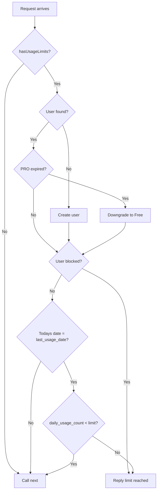
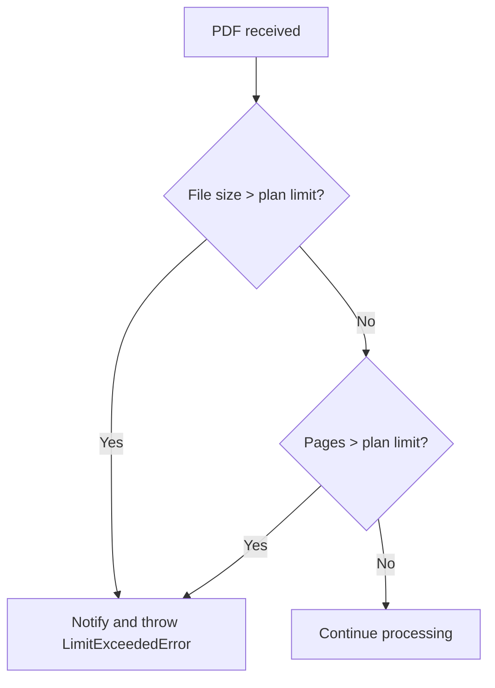

# Usage Limits

## Overview

The bot enforces daily usage limits based on the user's plan. Limits are checked by `usageLimitMiddleware` and accounted for by `BaseHandler.runWithUsage`.

## Plan Limits

| Plan | Daily Operations | Max File Size | Max Pages |
|------|------------------|---------------|-----------|
| Free | 3 | 10 MB | 50 |
| PRO | 50 | 50 MB | 1,000 |

PRO access lasts 30 days from the purchase date.

## Middleware Decision Flow

## Usage Increment

When a handler reserves an operation:

1. `incrementUsage` atomically checks the current date and counter.
2. If the counter is below the plan limit, it increments and returns the updated user.
3. If the limit is reached, it returns `null` and the handler notifies the user.

## Usage Decrement

If processing fails before delivery, `runWithUsage` decrements the counter so the failed attempt does not count against the daily quota.

## File and Page Limits

`BaseHandler.checkLimits` compares the incoming file size and PDF page count against plan-specific constants before processing begins.

