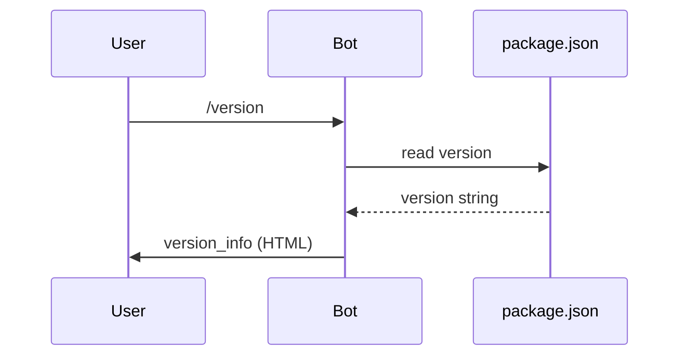
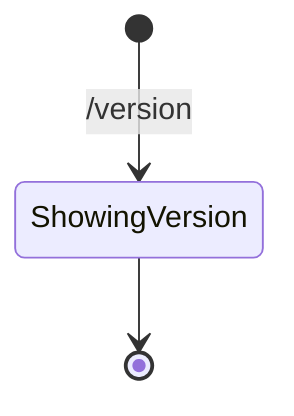

# Version

## Overview

The `/version` command displays the current bot version and developer information.

## Business Rules

- No usage limit is consumed.
- The version is read from `package.json`.

## User Flow

## State Machine

## Technical Notes

- Handler: `VersionHandler`.
- Uses `formatString` to inject the version into the localized message.
- Message is sent with `parse_mode: 'HTML'`.
